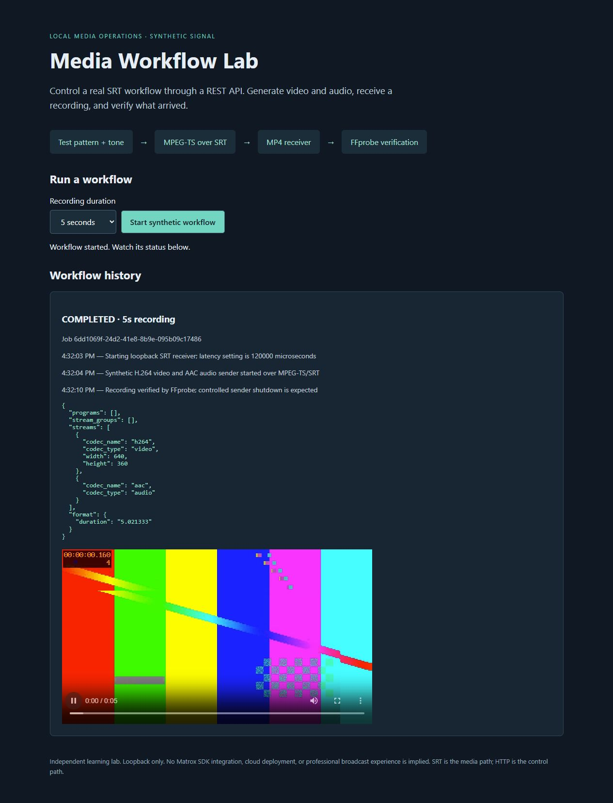
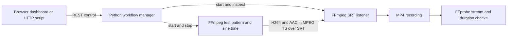

# Media Workflow Lab

[](https://github.com/robcorbisiero/media-workflow-lab/actions/workflows/verify.yml)

A local proof of concept for controlling a **real synthetic audio/video workflow through a REST API**. Python starts an FFmpeg source, sends MPEG-TS over loopback SRT, records an MP4 at a separate FFmpeg receiver, and verifies the recording with FFprobe.

This is an independent learning project developed with AI assistance. It is not a Matrox product integration, professional broadcast experience, a public-cloud deployment, or a production broadcast system. Only generated test patterns and tone are used.



## Media and control paths



HTTP controls processes and reports state; SRT transports the media. The receiver's recording duration controls a bounded workflow. A sender-side broken pipe after successful receiver completion is expected; it is not sufficient evidence of a failed recording. Receiver exit status and independent probing determine success.

## Run on Windows

Requires Python 3.11 or newer and FFmpeg/FFprobe with SRT, libx264, and AAC support. No Python packages, account, camera, cloud subscription, or API key are needed.

1. Download an FFmpeg Windows build through the links on [FFmpeg's official download page](https://ffmpeg.org/download.html). The tested Gyan essentials build includes the required tools. Extract it outside the repository; do not commit its binaries.
2. From this repository, start the lab, replacing the example directory with the extracted **bin** folder:

```powershell
git clone https://github.com/robcorbisiero/media-workflow-lab.git
Set-Location media-workflow-lab
./scripts/start.ps1 -FfmpegDirectory 'C:\tools\ffmpeg\bin'
```

Open http://127.0.0.1:5190. Start a five- or ten-second synthetic workflow. Wait for COMPLETED, inspect the H.264/AAC and duration result, then play the recording. The audio is an 880 Hz tone; choose a comfortable volume. Stop the server with Ctrl+C.

If the tools are already on PATH:

```powershell
python lab.py
```

On Linux, install Python and an FFmpeg build with the required protocol/encoders, then use the same Python command. Use `python lab.py --port 5191` if the HTTP port is occupied. The service binds only to IPv4 loopback.

## Automated verification

With FFmpeg/FFprobe on PATH, or after setting their full executable paths:

```powershell
$env:FFMPEG_PATH = 'C:\tools\ffmpeg\bin\ffmpeg.exe'
$env:FFPROBE_PATH = 'C:\tools\ffmpeg\bin\ffprobe.exe'
python -m unittest discover -s tests -v
```

The suite includes real SRT transport and recording tests, HTTP start/status/media retrieval, conflicting starts, stop/restart, startup failure/recovery, duration validation, token checks, host checks, and path isolation. Media tests skip when tools are missing; a skipped run is not evidence of successful media processing. CI explicitly requires SRT and libx264 before running the suite.

## REST API

| Method | Path | Behaviour |
| --- | --- | --- |
| GET | /api/health | Reports the server and whether media tool paths are configured; not a live-stream health guarantee |
| POST | /api/jobs | Starts a synthetic job with JSON `{"seconds":5}`; returns 202 |
| GET | /api/jobs | Lists this server run's workflow state and verification results |
| GET | /api/jobs/{id} | Reads one workflow |
| POST | /api/jobs/{id}/stop | Requests idempotent stop with JSON `{}` |
| GET | /media/{id}/recording.mp4 | Serves a completed recording only |

Mutations require `Content-Type: application/json` and an `X-Lab-Token` header. The dashboard supplies a fresh per-server token. [The PowerShell walkthrough](scripts/api-walkthrough.ps1) reads that token from the local dashboard without printing it, then starts and checks one workflow. Only fixed synthetic inputs are accepted; the API cannot accept shell commands, arbitrary input URLs, paths, or uploads.

```powershell
./scripts/api-walkthrough.ps1
```

## Operational evidence

Each job writes receiver/sender logs, a result JSON file, and, on success, recording/probe files beneath ignored `artifacts/{job-id}`. Do not treat a partial file from a stopped job as a verified recording. Job history is in memory and resets when the server restarts; artifacts remain on disk. One workflow runs at a time, recording duration is 3–15 seconds, and a server run permits at most 20 jobs.

[Troubleshooting and acceptance checks](docs/runbook.md) · [Learning walkthrough](docs/learning.md)

## OBS interoperability

The [feed interruption and recovery exercise](docs/obs-recovery.md) deliberately stops and restarts the synthetic sender while OBS keeps recording, then checks the recorded media before, during and after the fault.

An optional Windows exercise now sends the synthetic feed into a real OBS Media Source and verifies OBS's own timed recording. [Run the OBS walkthrough](docs/obs-interop.md). This is separate from the HTTP dashboard and headless CI. [Verification evidence](docs/verification.md).

## Deliberate limits

- OBS input interoperability was exercised with synthetic media on loopback. No real cameras, SDI, NDI, Matrox SDK, or external contribution feed was exercised.
- SRT runs unencrypted on loopback. Do not expose the HTTP server or SRT endpoint to another network. The local token is not production authentication.
- The 120000 microsecond SRT latency parameter is a configuration value, not a measured end-to-end latency result.
- A valid recording proves bounded local media processing, not packet-loss resilience, lip-sync quality, long-running stability, failover, or live-event readiness.
- Cloud deployment, infrastructure automation, and live-source interoperability remain separate future milestones, requiring their own tests and any account/cost approvals.

## References

- [FFmpeg protocols and SRT options](https://ffmpeg.org/ffmpeg-protocols.html)
- [FFprobe documentation](https://ffmpeg.org/ffprobe.html)
- [Matrox ORIGIN framework overview](https://video.matrox.com/en/product/broadcast-developer/origin-framework/), a research reference rather than an integration claim.
